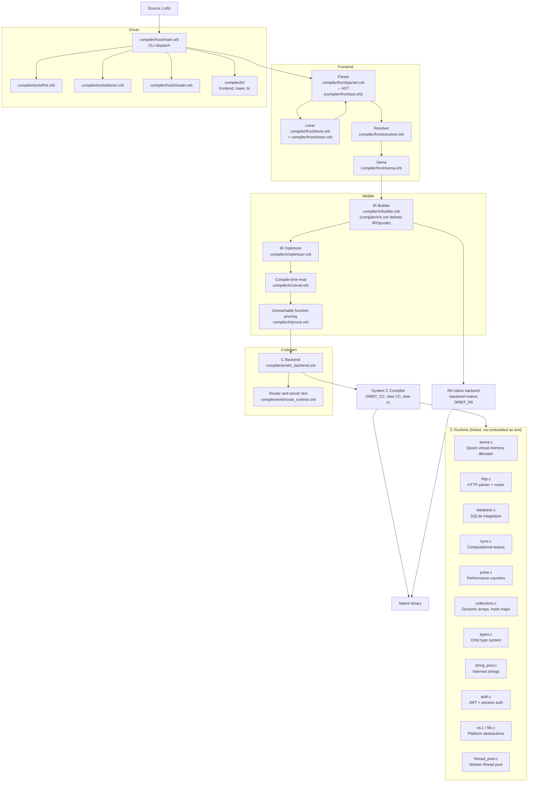

# Orbit Architecture

> Deep-dive reference for contributors and integrators. This page describes the
> architecture that exists today: the self-hosted pipeline in `compiler/`, the C
> runtime in `runtime/`, the gates in `scripts/`, and the test corpora in
> `tests/`. For the bootstrap trust model see
> [architecture/SOVEREIGNTY.md](architecture/SOVEREIGNTY.md).

---

## Overview

Orbit is an ahead-of-time compiler that turns `.orb` source into native binaries
through C. The compiler is written in its own language, in `compiler/**/*.orb`, and
bootstraps from a committed C file that it generated itself. The runtime is a
small, portable C library linked into every generated server.

If you're new, you don't need this file yet. Build something first with
[Getting Started](GETTING_STARTED.md), then come back when you want to know how
the pieces fit.

---

## Compiler Pipeline

One driver, `compiler/host/pipeline.orb`, calls each stage in order. The lexer is
driven by the parser: `initParser` owns a `Lexer` and pulls tokens from it, so
lexing and parsing are one pass, not two.



### Stage notes

| Stage | Module | What it does | On failure |
|---|---|---|---|
| Parse | `compiler/front/parser.orb` | Build the AST. Member names after `.` accept keyword and type tokens and resolve by text. | `ParserDiagnostic` rendered as an error card with a source excerpt and a hint. |
| Resolve | `compiler/front/resolver.orb` | Load `import`ed modules, flatten them into one AST. | `Import error: <detail>` per unresolved import, exit non-zero. |
| Sema | `compiler/front/sema.orb` | Scope and type resolution. Builds the function return-type table the builder and backend read. | First error rendered as an error card; remaining errors listed to stderr. |
| Build | `compiler/ir/builder.orb` | AST to IR. `IRModule` of `IRInstruction` over the `IROpcode` union: arithmetic, comparison, control flow, calls, `alloc`/`free`, field access, the collection opcodes, the `result_*` opcodes, and the union opcodes. | No failure path of its own. Sema has already rejected bad code; an expression the builder cannot type degrades to `unknown` in the IR rather than aborting, which the IR type-consistency verifier (`verifyModuleTypes`) and the unknown-type census/ratchet now police. |
| Optimize | `compiler/ir/optimizer.orb` | Pattern rewrites over the IR; reports `patterns_applied` and `span_saved`. | Not fatal. |
| CTE | `compiler/ir/cteval.orb` | Compile-time evaluation and folding; reports fold count. | Not fatal. |
| Prune | `compiler/ir/prune.orb` | Drops the functions that no entry point (`main`, `orbit_main`, `*_main`, a route) or extern reaches; a module with no entry point is left whole, so an imported library costs only what the program uses. A String or Sym operand spelling a function name counts as a reference. Runs after CTE; `--emit-ir` runs before it. `build --verbose` prints the count dropped. | Not fatal. |
| C backend | `compiler/emit/c_backend.orb` | Emits C. Routes take a separate path: `compiler/emit/route_runtime.orb` supplies the preamble, router, and `main` as generated text, and the route hash is a 64-bit FNV-1a over `METHOD + ':' + PATH`. | No failure path of its own; the driver reports an unwritable output path or a non-zero exit from the C compiler. |
| Invoke `cc` | `compiler/host/pipeline.orb` | Writes the C to a **constant** filename, then invokes the C compiler. | The child's exit code and output are reported verbatim. |

Both optimization passes honour the same kill switch: `ORBIT_NO_CTE=1` skips
them and emits pre-pass IR, and their counters are reported rather than dropped.

### Config declarations: `port` reaches the server; the rest are reserved

Top-level `port`, `cors`, `db`, and `env` declarations parse as `ConfigDecl`
nodes (`compiler/front/parser.orb`, `parseConfigDecl`) and typecheck. `port` is
the one with a runtime effect. Sema requires an integer literal in 1..65535
(`checkConfigDecl` in `compiler/front/sema.orb`, with diagnostic E1008 otherwise). The
builder reads it into `IRModule.configPort` (`compiler/ir/builder.orb`), and the
generated `main` (`compiler/emit/route_runtime.orb`) initializes `int port` from
it — with `argv[1]` still the override. A program that declares no port emits
exactly the old `port = 3000`, byte for byte.

`cors`, `db`, and `env` parse and typecheck with no runtime effect. The emitted
server always initializes the database at `.orbit/data/app.db` when models are
present. It emits no CORS or environment handling from the declarations. What
is read is recorded in the [project snapshot](STATUS.md).

### Why the intermediate C has a constant name

`compiler/host/pipeline.orb` writes the generated C to `orbit_selfhost_build.c` under
`TEMP`, not to a name derived from the output. C compilers embed the source path
in anonymous-struct names and in type diagnostics. A name derived from the
output, rather than the fixed `orbit_selfhost_build.c`, would break the fixed-point
comparison even when the emitted code is byte-identical. This one choice is what
makes "did the compiler change its mind?" answerable as a hash comparison.

### Linking the runtime

The generated C is compiled with `-I runtime`. The runtime's `runtime.h` is an
aggregation header: it includes the `.c` files directly, so the unity build
recompiles the whole runtime with the program. The driver adds
`-DORBIT_WITH_NET` and, on Windows, `-lws2_32` only when the IR uses the
network (routes, the HTTP client, a database), and adds `-DORBIT_WITH_DB` plus
the vendor SQLite flags only when the IR uses the database. See
[Program start-up](STARTUP.md). On the DB path it links `runtime/vendor/win-x64/sqlite3.lib` instead
of `-lsqlite3`.

A program that needs no database links the prebuilt `libruntime_net.a` instead
(one member per runtime module, so only the modules the program names are
linked), and the driver compiles only the program with `-DORBIT_SEPARATE_COMPILATION`.
On 2026-10-27 (gcc 16.2.0, `ORBIT_CCACHE=0`, best of 3) `examples/hello.orb`
builds in 1.3 s linked against 3.4 s for the unity build. The driver looks for the archive in `lib/`
beside the runtime directory, then in `.orbit/lib/` beside it, which is where
`python scripts/mklib_runtime.py` writes it. It uses the archive only when
`libruntime_net.a.stamp`, written next to the archive, has one
`<name> <FNV-1a-32 hex>` line for each `.c` and `.h` file in the runtime
directory (`test_*` excluded), and every digest equals the file's digest now. An archive that is missing, unstamped
or older than a runtime edit is skipped without a message, and the build is the
unity build above (`--verbose` names a stale or unstamped archive).

| Variable | Effect |
|---|---|
| `ORBIT_LINK_RUNTIME` unset | Link the archive when it is found and fresh, else unity. |
| `ORBIT_LINK_RUNTIME=1` | Link the archive for any program without a database. A missing archive fails the C step. The test suite lane uses this. |
| `ORBIT_LINK_RUNTIME=0` | Always unity. `scripts/dev.py` defaults it to `0`; `make all` sets `1` for the `suite` and `suite_std` gates only. |
| `ORBIT_RUNTIME_LIB=<path>` | Use this archive instead of the lookup, with no freshness check. |

`scripts/werror_gate.py` puts `-Werror` on generated C, and that is the strict
contract. The driver itself only passes `-Wall`.
`ORBIT_CCFLAGS_EXTRA` is the escape hatch the bootstrap uses for its own
low-memory profile.

Note that the include path is the literal relative string `runtime`, not an
absolute one baked in at build time. `orbit build` therefore only finds the
runtime headers when the **working directory** contains a `runtime/`
directory. Run the compiler from the repository root, or from a directory where
you have arranged one, or the C step fails with
`fatal error: socket_compat.h: No such file or directory`. This is the same
family of assumption as the `std/` lookup described in
[Libraries](LIBRARIES.md). The tree layout is part of the contract, and nothing
checks it at install time.

### The value model: one machine word, no tag

Every value the backend materialises is a register holding a single machine
word. There is no tag, no header, no type byte, and no boxing. A register is
declared `orbit_int` or `void*` - sometimes `orbit_float` - and every
conversion between them goes through a cast on a `uintptr_t`:

```c
r_2 = (orbit_int)(uintptr_t)(takesStr((orbit_string)(r_1)));
```

Three things follow, and all three are user-visible.

**The C cast comes from the static type alone.** `mapTypeToC`
(`compiler/emit/c_backend.orb:264`) turns an Orbit type name into a C type, and the
callee's declared parameter type is what decides the cast at a call site. The
runtime is never asked whether the word it was handed is of that type, because
there is nothing to ask. A function parameter declared `s: string` produces
`takesStr((orbit_string)(r_1))` no matter what produced `r_1`.

**An unannotated binding is assumed to be a string.** Sema does not track the
type of a local bound to a literal, so `val v = f()` reads back as `unknown`.
Such a binding is allowed through on purpose (`isInterpolatable`,
`compiler/front/sema.orb:732`, which returns true for `unknown` and says why in the
comment above it). Where the backend then has to guess, it guesses
string. Passing such a binding to a `string` parameter compiles cleanly and
dereferences an integer as a pointer:

```orbit
fn takesStr(s: string) -> int { return s.len() }
fn g() -> int { return 11 }
fn main() -> int { print(takesStr(g()))  return 0 }
```

`orbit check` reports no errors and the program segfaults. With a `float` in
the same position the mistake is louder, because the cast is a C-level
inconvertible and the build stops: `error: cannot convert to a pointer type`.
Both failures are the same missing runtime tag. Annotating the binding and the
argument types is the whole workaround.

**`print` has no float form.** `print` on a value the backend settled on as
`float` emits `printf("%lld\n", (long long)(r))` - the value is a correct
`orbit_float`, and the fraction is thrown away by the format string. Verified:
`val a = 1.5` then `print(a)` prints `1`; `a + 2.0` prints `3`. There is no
`%f` path and no float overload of `print` in the emitter.

For a user, the summary is: **annotate your bindings, and treat a value that
crosses a `string` boundary as the one place the compiler will not help you.**
`docs/KNOWN_LIMITATIONS.md` records what this costs. `docs/LIBRARIES.md`
covers the other place the same missing types bite, at import boundaries.

---

## Self-Hosting Chain

The compiler is its own first customer. `compiler/selfhost/stage3.exe.c` is the
committed output of the compiler compiling itself, and it is the root of trust.

```text
compiler/selfhost/stage3.exe.c   (committed canonical C)
        │  gcc (ubuntu-latest) / clang (windows-latest) [CI-verified]
        ▼
   seed compiler  ──builds──▶  compiler/host/main.orb
        │                        │
        │                        ▼
        │                  the same canonical C, byte for byte
        ▼
   seed2 ──▶ chain2 ──▶ chain3
```

`scripts/verify_seed.py` runs that chain and reports four checks: the seed
builds; the C the seed emits for `compiler/host/main.orb` equals the canonical; the C
emitted by chain2 equals the canonical; the C emitted by chain3 equals the
canonical. The last two exist because a chain can fix a point at stage one and
drift afterwards.

Terms in this section (canonical, seed, seed2, chain2, chain3, promote,
`PUBLISHED_C`, amalgamate) are defined once in the
[Sovereignty glossary](architecture/SOVEREIGNTY.md#glossary---canonical-bootstrap-terms)
and not redefined here. Promotion is the only operation that replaces the
canonical. It is explicit and reviewable. For what is trusted vs verified
and where amalgamation fits, see the
[trust-boundary diagram](architecture/SOVEREIGNTY.md#trust-boundary-what-is-trusted-vs-verified).

---

## Subsystem Reference

### Orbit Arena (virtual-memory epoch allocator)
File: `runtime/arena.c`

The arena reserves a large virtual address window at startup and commits pages on
demand. Allocation is a monotonically growing bump pointer. There is no
per-object free.

**Requests are bracketed by a whole-arena reset, not by a checkpoint.** The
generated connection loop calls `orbit_arena_reset(thread_arena)` before every
`orbit_handle_request` (`compiler/emit/route_runtime.orb:485`), so each request
starts from a reset arena. `orbit_arena_reset` is not O(1) and not a rewind: it
releases the chained overflow segments and decommits every page past the hot
retention watermark (at `runtime/arena.c:515`, where the watermark itself is
`ORBIT_ARENA_HOT_RETENTION_LIMIT`, 256 KB, at `:52`).

`orbit_arena_checkpoint` and `orbit_arena_rewind` exist
(`runtime/arena.c:565,575`), and a rewind is an O(1) bump-pointer restore.
Nothing in the generated server path calls them. Outside `runtime/arena.c` and
`runtime/test_arena.c`, the only references are the counter fields in
`runtime/performance.h`. So `arena_checkpoint_count` and `arena_rewind_count`
remain zero in a running server. The checkpoint API is available to hand-written
C. The HTTP path uses whole-arena reset.

The request path does not use the pool. Each worker creates one 128 KB arena
when its thread starts (at `compiler/emit/route_runtime.orb:368-369`, where the
emitted comment is "Each thread owns its private arena - zero pool contention").
It resets the arena before every request (`:485`) and destroys it when the loop
ends (`:521`).
`runtime/arena_pool.c` is initialized for process-startup scratch work only
(`:566`, `:585-587`) and has no caller on the request path.

`runtime/oracle.c` used to implement the *Orbit Arena Oracle*, a per-route
prediction of how many bytes a route needs. It used EMA with a cold-start sample
count and a safety margin, so a session could pre-reserve that much and serve
allocations from an O(1) TLS bump path. Nothing in the generated server ever
opened a session: `tls_oracle_session.active` stayed 0 and the prediction
tables stayed cold. The last code that read those tables was the ledger's
`arena_overflow` / `arena_max_bytes`. Those are now measured from the arena that
served the request (see [PERF.md](PERF.md), "Arena telemetry is a fold"). With
no consumer left, the predictor is gone, and with it the TLS branch the
allocator carried on every allocation. The predictive pre-reservation design is
in the history rather than the tree: `git log -- runtime/oracle.c`.
See [ARENA.md](ARENA.md).

---

### Orbit Kynx (computational leases)
File: `runtime/kynx.c`

Each route handler gets a **lease**: a budget of CPU time, arena memory,
DB queries, and response size.
If the handler exceeds its budget, Kynx rejects the request with HTTP 429 before writing the response.
Under pressure the admission state machine (STABLE / SHAPED / GUARDED / SIEGE)
tightens budgets. In **SIEGE** only critical routes (`/health`, `/auth`, `/`)
keep an emergency budget, and the rest are rejected. See [KYNX.md](KYNX.md).

The lease and admission API lives in `runtime/kynx.c`. The unit tests are
`runtime/test_kynx.c`, built with `-DORBIT_KYNX_TEST`. A live route-limit gate
runs against a real server: `scripts/kynx_gate.py route-limit`.

---

### Orbit Pulse (performance counters)
File: `runtime/pulse.c`

RDTSC-based wall-clock and CPU-cycle measurements, rendered as the `/_pulse`
dashboard and its JSON endpoint. Per request it keeps a count, a total, a min
and a max. There is no histogram, so there is no P50 / P95 / P99 to compute,
and `system.*` exposes no latency distribution either. The hardware energy
accounting sits alongside it rather than on top of it:
`runtime/energy.c` samples the platform energy sensor on its own thread and
`runtime/ledger.c` records the accounting entries. See [ENERGY.md](ENERGY.md).

---

### Orbit Cluster (single-host process orchestration)
File: `compiler/host/cluster.orb`

`orbit cluster` builds and supervises N local processes of one service:
`up`, `status`, `drain <node>`, `restart --rolling`, `down`, `logs <node>`.
Node state lives in `.orbit/cluster.json`. Logs default to `.orbit/logs`.
Nodes are on one host, on consecutive ports from a base. This is process
supervision, not a distributed cluster: there is no gossip, no membership table,
and no leader election. See [CLUSTER.md](CLUSTER.md).

---

### Frontend canonical TIR
Files: `compiler/tir/entry.orb`, `lower.orb`, `tir.orb`

`orbit frontend <file.orb> -o out.tir` runs the self-hosted frontend alone and
emits canonical typed IR, without invoking the C backend. It is the debugging
interface for the frontend and the fixture format for `tests/frontend/expected/`.
See [architecture/TYPED_IR.md](architecture/TYPED_IR.md).

---

### Formatter and Doctor
Files: `compiler/tools/fmt.orb`, `compiler/tools/doctor.orb`

`orbit fmt` formats `.orb` source and writes only on success. `orbit fmt --check`
lists files that need formatting. `orbit doctor` is a read-only project scan
reporting findings `D001` through `D008` (toolchain, route conflicts, unused
`private fn`, unused `model`, unknown `system` member, trailing whitespace,
missing final newline, and files that do not compile). See
[DOCTOR.md](DOCTOR.md).

### There Is No Build Cache and No Config Loader

There is no compiled-binary cache keyed on a source hash: every build runs the
pipeline. There is no project config file: the output name,
port, and the arena/Kynx/logging knobs are not read from any config
file. `scripts/orbit_ccache.py` caches C compilations for the **gates** -- the
self-host chain and the runtime C tests. It does not cache user builds, and it
is not part of the compiler.

---

## Thread Model

```text
Main thread
  └── compiler/host/main.orb
        ├── lex → parse → resolve → sema → build → optimize → cteval → prune → C  (single-threaded)
        ├── write the generated C
        └── spawn the C compiler subprocess

HTTP server (generated code)
  └── worker pool (runtime/thread_pool.c, count from ORBIT_WORKERS or the CPU count)
        └── per-request: reset the thread's own arena → handle → respond
```

Worker count is resolved in the generated `main`: `ORBIT_WORKERS` if positive,
otherwise the platform CPU count, clamped to 1..64, and printed in the startup
banner. The acceptor hands sockets to workers through a lock-free queue, so
contention is on the queue and not on a shared stdout lock.

---

## Request Path

```text
accept (acceptor thread, server socket)
  -> lock-free accept queue, one per worker (orbit_accept_q)
  -> worker resets its own per-thread arena (orbit_arena_reset before each orbit_handle_request)
  -> no pool acquire/release on the request path (the pool serves startup only)
  -> Kynx admission check + per-route lease
     (orbit_kynx_check_route, orbit_kynx_lease_create_for_route;
      over-budget -> HTTP 429; SIEGE admits only /health, /auth, /)
  -> router dispatches to the generated handler (orbit_handle_request)
  -> handler runs (SQLite via runtime/database.c when models are present;
     auth via runtime/auth.c)
  -> response written (no pool release: the worker's arena is reset before the next request)
```

The connection loop that brackets each request with `orbit_arena_reset`
followed by `orbit_handle_request` is emitted by
`compiler/emit/route_runtime.orb`. The arena pool lives in `runtime/arena_pool.c`
(startup scratch work, not the request path). Leases and admission live in
`runtime/kynx.c`, and persistence in `runtime/database.c`.

---

## File Index

### Compiler (Orbit source, `compiler/`)

| Path | Role |
|---|---|
| `compiler/host/pipeline.orb` | Build driver: stage order, C emission, C compiler invocation |
| `compiler/host/main.orb` | CLI entry point and subcommand dispatch |
| `compiler/front/lexer.orb` | Tokeniser (skips a leading UTF-8 BOM) |
| `compiler/front/token.orb` | Token type and metadata |
| `compiler/front/ast.orb` | AST node definitions |
| `compiler/front/parser.orb` | Parser entry point |
| `compiler/front/resolver.orb` | `import` resolution and module flattening |
| `compiler/front/sema.orb` | Semantic analysis, scopes, function return types |
| `compiler/ir/ir.orb` | `IROpcode`, `IRInstruction`, `IRModule` |
| `compiler/ir/builder.orb` | AST to IR, plus expression and argument type inference |
| `compiler/ir/optimizer.orb` | IR pattern rewrites |
| `compiler/ir/cteval.orb` | Compile-time evaluation and folding |
| `compiler/ir/prune.orb` | Removal of unreachable functions |
| `compiler/emit/c_backend.orb` | IR to C, including the non-route path |
| `compiler/emit/route_runtime.orb` | Generated preamble, router, and server `main` text |
| `compiler/host/cluster.orb` | `orbit cluster` subcommands |
| `compiler/tools/doctor.orb` | `orbit doctor` checks and rendering |
| `compiler/tools/fmt.orb` | `orbit fmt` |
| `compiler/host/extern.orb` | `orbit_*_selfhost` extern declarations (typed) |
| `compiler/tir/entry.orb` | `orbit frontend` driver |
| `compiler/tir/lower.orb` | AST to typed IR lowering |
| `compiler/tir/format.orb` | Canonical TIR definitions and serialisation |
| `compiler/selfhost/stage3.exe.c` | Committed canonical generated C, the root of trust |

### Runtime (hand-written C, `runtime/`)

| Path | Role |
|---|---|
| `runtime/runtime.h` | Aggregation header; includes the `.c` files |
| `runtime/arena.c` | Epoch virtual-memory allocator: create and destroy. Allocation, reset, checkpoint, child, stats, OOM configuration and the global arena are `arena_alloc.c`, `arena_reset.c`, `arena_checkpoint.c`, `arena_child.c`, `arena_stats.c`, `arena_oom.c` and `arena_global.c` |
| `runtime/arena_pool.c` | Pool of arenas for startup and hand-written scratch work (not the request path) |
| `runtime/string_pool.c` | String interning |
| `runtime/collections.c` | Arrays, hash maps, bytes |
| `runtime/types.c` | Runtime type system |
| `runtime/file.c` | File I/O helpers |
| `runtime/os.c` | OS abstractions |
| `runtime/builtins.c` | Builtin functions exposed to generated code |
| `runtime/crypto.c` | Hashing and crypto primitives |
| `runtime/hyperdrive.c` | Throughput-oriented runtime helpers |
| `runtime/selfhost.c` | Host services the compiler itself uses (exec, files, env) |
| `runtime/energy.c` | Energy accounting |
| `runtime/ledger.c` | Ledger and accounting records |
| `runtime/database.c` | SQLite bindings and model persistence |
| `runtime/auth.c` | JWT and session auth |
| `runtime/http.c` | HTTP server, request parser, router |
| `runtime/kynx.c` | Computational leases and admission control |
| `runtime/pulse.c` | Performance counters |
| `runtime/thread_pool.c` | Worker thread pool |
| `runtime/inline.h`, `performance.h`, `socket_compat.h` | Shared headers |
| `runtime/vendor/` | SQLite: `sqlite3.h` and the `win-x64` import library and DLL |
| `runtime/test_arena.c` | Arena unit tests, including cross-request isolation |
| `runtime/test_http_parse.c` | HTTP parser unit tests |
| `runtime/test_kynx.c` | Kynx unit tests (needs `-DORBIT_KYNX_TEST`) |

### Standard library and wrappers

| Path | Role |
|---|---|
| `std/` | Orbit standard library. 19 modules, all of which compile and merge into one program: `test/assert.orb`, `convert/convert.orb`, `convert/codec.orb`, `string/string.orb`, `string/regex.orb`, `collections/lists.orb`, `bytes/bytes.orb`, `fs/file.orb`, `hash/hash.orb`, `io/io.orb`, `log/log.orb`, `time/time.orb`, `sys/proc/process.orb`, `sys/term/color.orb`, `sys/crypto/jwt.orb`, `sys/bytes/bitwise.orb`, `sys/http/client.orb`, `sys/random/random.orb`, `json/json.orb` |
| `std/quarantine/` | Modules that are specified and not implemented, as `*.orb.quarantined`. Not `.orb` on purpose: a file the parser cannot read breaks `fmt --check` on every run. Currently `option` alone (no generic unions); `bitwise` left on 2026-10-18 as `std/sys/bytes/bitwise.orb`, and the import-all imports it |
| `lib/` | One module: `arena.orb`, a counted region and a bound, not an allocator. There is no socket API in the language or the runtime |

`std/` holds **19 modules, 19 of 19** compiling and merging into one program,
pinned by `tests/std/test_imports.orb`, which imports all nineteen into one
program. `convert/convert.orb` owns the number-to-text bindings and
`json/json.orb` provides the quoting helper for hand-built bodies. The
invariant is one definition per program: when two modules need the same C
symbol, the dependent module imports the owning module.

### Gates and tooling (`scripts/`, Python 3, standard library only)

| Path | Role |
|---|---|
| `scripts/build_selfhost.py` | Bootstrap the self-hosted compiler; `--check-stale` for CI, `--promote` to replace the canonical |
| `scripts/verify_seed.py` | Hermetic fixed-point chain; `--release` pins the published hash |
| `scripts/parity_selfhost.py` | every probe in `tests/parity/probes/` against its golden (33 today); `--update` to regenerate |
| `scripts/test_suite.py` | Language and std behaviour suites, driven by process exit code |
| `scripts/werror_gate.py` | `-Werror` over generated C |
| `scripts/fuzz_frontend.py` | Frontend fuzzing |
| `scripts/cli_probe.py` | CLI subcommand, help, and exit-code contract |
| `scripts/routes_probe.py` | Route argument normalisation |
| `scripts/kynx_gate.py` | Live Kynx gate (live/route-limit/burst) + stdlib load generator (load) |
| `scripts/amalgamate.py` | Inline the project includes into `dist/orbit_bootstrap.c` |
| `scripts/orbit_ccache.py` | Content-addressed C compile cache for the bootstrap gates |
| `scripts/orbit_routes.py` | Path normalisation shared by gates and the server |
| `scripts/orbit_output.py` | Shared gate output helpers |
| `scripts/measure_selfhost.py` | Bootstrap-side measurement |
| `scripts/kynx_gate.py load` | Load generator for live-service measurement |
| `scripts/build_seed.sh`, `.bat` | Detect a C compiler and build the seed |
| `scripts/install.sh`, `install.ps1` | Install the fixed-point compiler on `PATH` |

---

## Tests

| Corpus | Location | How it runs | Assertion |
|---|---|---|---|
| Language behaviour | `tests/suite/` | `scripts/test_suite.py` | The test program compiles, runs, and its **exit code** matches `// expect-exit <N>`. |
| Standard library | `tests/std/` | `scripts/test_suite.py --dir tests/std` | Same convention. |
| Parity | `tests/parity/probes/` + `tests/parity/golden/` | `scripts/parity_selfhost.py` | For an exit-0 probe, the SHA-256 of the generated C matches the golden. For a non-zero probe, the normalised diagnostics match. |
| Frontend TIR | `tests/frontend/` + `expected/` | `orbit frontend` | The emitted canonical TIR matches the expected file. |
| Runtime C | `runtime/test_arena.c`, `test_file.c`, `test_oom.c`, `test_http_parse.c`, `test_kynx.c` | compiled and run directly | The C harness's own assertions. |
| Auth | `tests/auth/auth_harness.c` | compiled and run directly | Bearer token, role, and `has_role` behaviour against the real runtime. |
| Doctor | `tests/doctor/` | `orbit doctor tests/doctor` (manual) | Exactly one `D002`, no finding for two methods sharing a path, exit code 1. |

Each corpus keeps its own inventory in its `README.md`, and every gate prints
the total it just ran, so the counts live with the corpus instead of in a
second place that can rot.

Everything above runs in CI on ubuntu/gcc and windows/clang, plus an
eight-leg stress job that re-runs the fixed-point chain independently to hunt
run-to-run flakiness. The full gate sequence, in order, is in
[ENGINEERING.md](../ENGINEERING.md) §8.

---

## Native Backend

`orbit build --backend=native` (or `ORBIT_BACKEND=native`) builds without a C
compiler. `compiler/host/pipeline.orb` runs the same front end, writes the IR
document that `--emit-ir` writes into the temp directory, and runs R6 on it.
R6 is a separate project (`github.com/joacokhzyx/orbit-r6`, MIT): it encodes
x86-64 itself, writes AMD64 COFF and links with GNU `ld`. It targets Windows
only.

There is no fallback. A program R6 refuses is a compile error that carries
R6's own diagnostic, and `--backend=c` builds it. The pipeline passes the
runtime archive directory in `R6_RUNTIME_DIR` and a temp directory in
`R6_TMPDIR`. How R6 is found and how a release lays it out is in
[Commands](COMMANDS.md#backends-c-and-native).

The gates that measure it are `suite_native` and `suite_std_native` in
`scripts/dev.py`. They build `tests/suite` and `tests/std` with
`--backend=native` and compare the same exit codes as the C lane. Without
`ORBIT_R6` they are skipped and the summary says so.

An in-tree backend written in Orbit (`compiler/native/`) is still open: see
native-backend in [ENGINEERING.md](../ENGINEERING.md).
